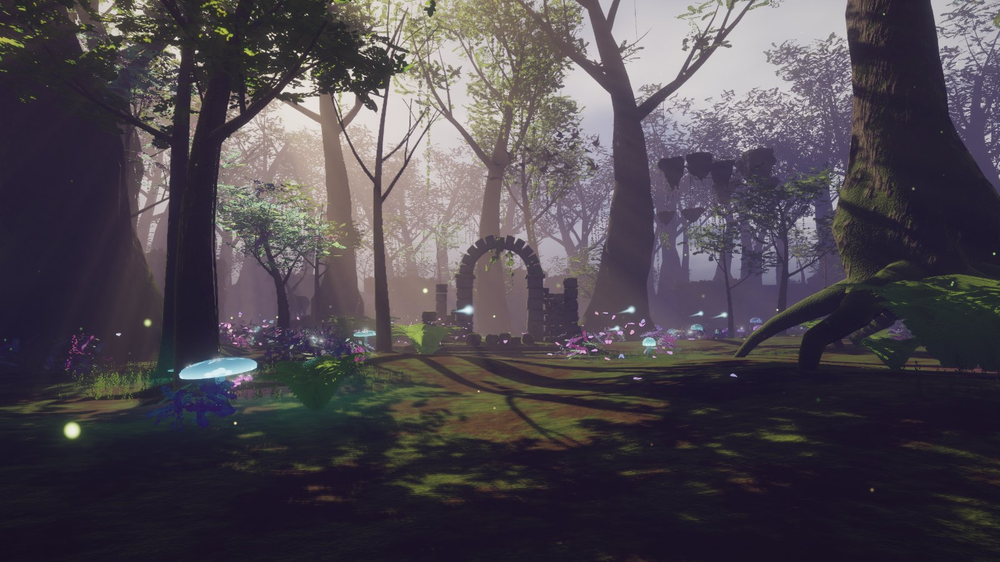
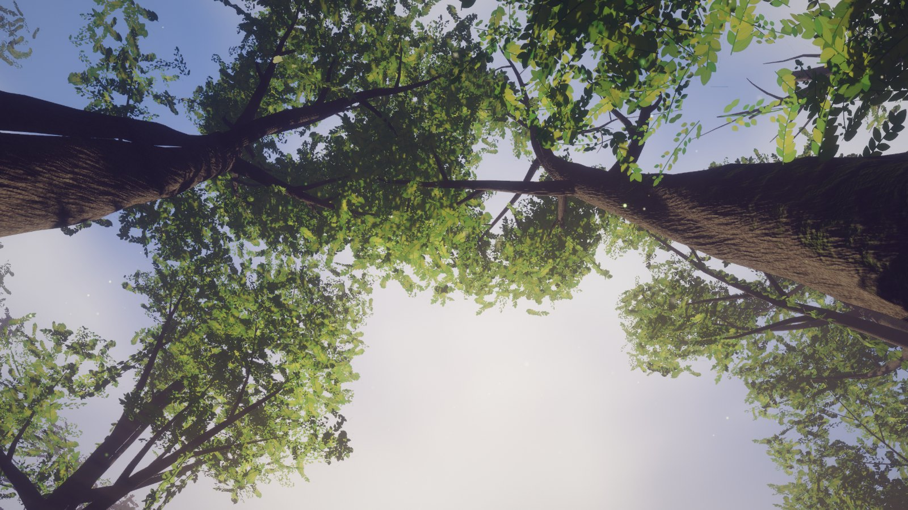
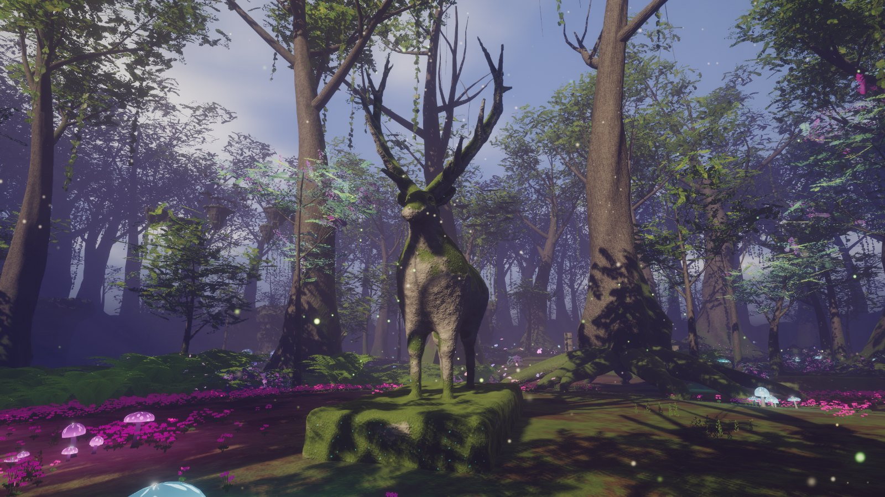
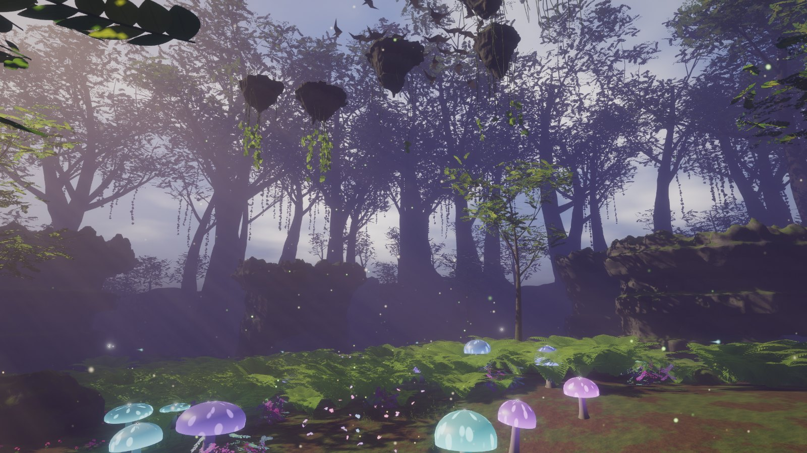
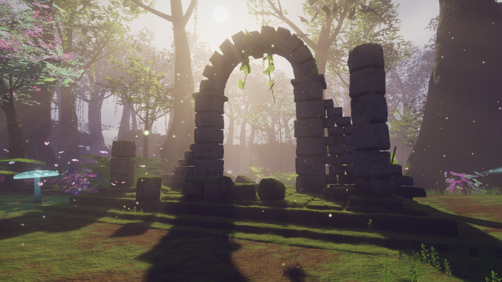
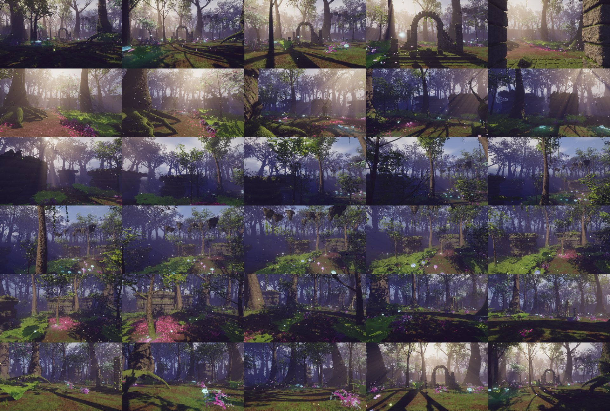

# forest-3d-browser

A real-time enchanted forest you can fly through in the browser. It is rendered with **WebGPU**,
and **everything is procedural**: no textures, models or other assets.
The whole thing ships as one self-contained `index.html` (~94 KB minified, ~37 KB gzipped).



## Run it
Open `index.html` in a WebGPU-capable browser (recent Chrome or Edge), or serve the folder with
any static server. Generating the world takes a few seconds on load.

| Control | Action |
|---|---|
| Click | Capture the mouse (pointer lock) |
| Mouse | Look around |
| W A S D | Move |
| Q / E | Down / up |
| Shift | Move faster |
| Esc | Release the mouse |

URL options:
- `?fly`: play the scripted 60 s fly-through
- `?pose=0..5`: fixed camera poses
- `?res=2560x1440`: force the internal render resolution

## What's in the scene
- Towering procedural trees with buttressed, twisted trunks, mossy bark and root arches.
  Leaves and branches sway in the wind.
- Height and distance fog, with warm haze toward the sun and blue/violet mist in the distance.
- Volumetric god rays through the canopy, from ray-marched shadow maps.
- Dappled sunlight from a camera-following shadow cascade.
- Mossy strata cliffs with overhangs, plus floating rocks with dangling vines.
- An overgrown ruined temple archway and a giant moss-covered stag sculpture. Both are
  modelled as signed distance fields and meshed with surface nets on load.
- Iridescent purple/pink bushes, magenta flower carpets, giant ferns and bioluminescent
  mushrooms that light the ground around them.
- Fireflies, glowing motes, pollen, wisps, butterfly swarms and two bird flocks.

| | |
|---|---|
|  |  |
|  |  |

Fly-through contact sheet (one frame every 2 s):



## How it works
- **Generation (once, on load).**
  - JavaScript builds the terrain heightfield, tree tubes and instance lists.
  - A WebGPU compute shader evaluates the SDF set pieces, and JavaScript meshes them with
    surface nets.
  - A 3D noise texture and a leaf atlas are generated on the GPU.
- **Each frame.**
  - Compute shaders cull instances (GPU-driven indirect draws).
  - Shadow cascade pass.
  - Forward HDR main pass with 4× MSAA and alpha-to-coverage foliage.
  - Compute post chain: half-res volumetric light, bilateral blur and bloom.
  - Composite: ACES tonemap, grade and dither.
- **No per-frame allocation in the frame loop's own code.** Buffers, descriptors and typed
  arrays are preallocated.

## Development
```bash
npm install
node tools/build.mjs        # bundles src/ into index.html (+ out/debug.html)
node tools/shoot.mjs out/shots out/debug.html 0,1,2,3,4,5 14   # pose renders at 2560x1440
node tools/perf.mjs index.html                                 # 60 s fly-through perf log
```

Source lives in `src/`:
- `main.js`: GPU setup and frame loop
- `world.js`: procedural generation
- `wgsl.js`, `post.js`: shaders
- `util.js`: math helpers

Measured performance and visual QA results are in [docs/REPORT.md](docs/REPORT.md).
